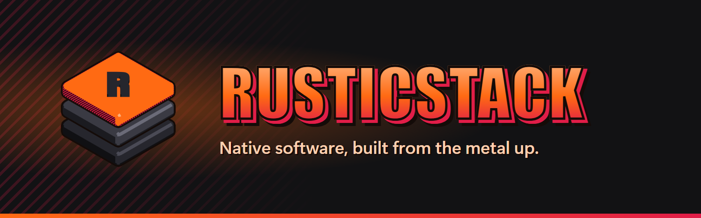

  

We build fast, native software in **Rust** and **Go**: desktop apps that feel like part of your
operating system, and self-hosted tools that keep your data on your own machines. No web
wrappers, no bloat, and nothing phoning home.

## Projects

<table>
  <tr>
    <td width="140" align="center"></td>
    <td>
      <h3><a href="https://github.com/RusticStack/Vaulter">Vaulter</a></h3>
      Tune, patch and mod Borderlands in one click: better graphics, fewer crashes, mods and bug
      fixes, without editing a single file. A native Windows 11 app written in Rust.  
      
    </td>
  </tr>
  <tr>
    <td width="140" align="center"><b>Sentinel</b></td>
    <td>
      <h3><a href="https://github.com/RusticStack/sentinel">Sentinel</a></h3>
      A fast, self-hosted CI engine built from scratch in Rust: quick feedback on pull requests,
      local-first caching, multi-machine scheduling and diagnostics that humans and coding agents
      can read. In early development.
    </td>
  </tr>
</table>

  

## How we build

- **Native first.** GPU-accelerated interfaces that follow your system's look and stay light
  on CPU and memory.
- **Yours to run.** Self-hosted and local-first by default; your data stays on your hardware.
- **Built to last.** Small dependencies, careful testing, and software that works offline.
